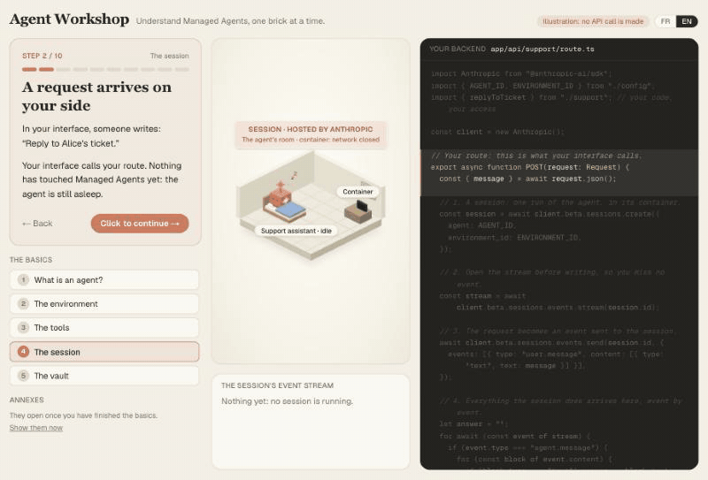
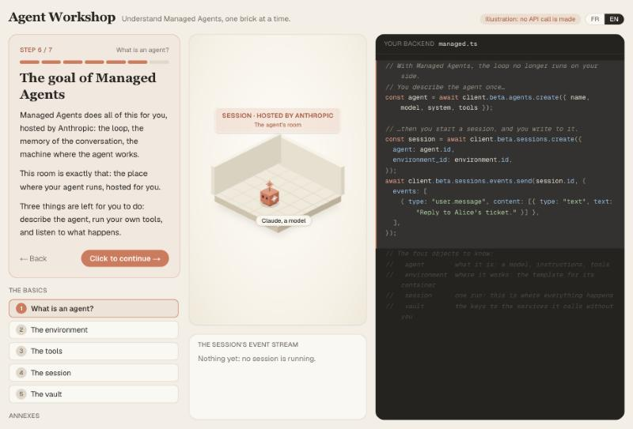
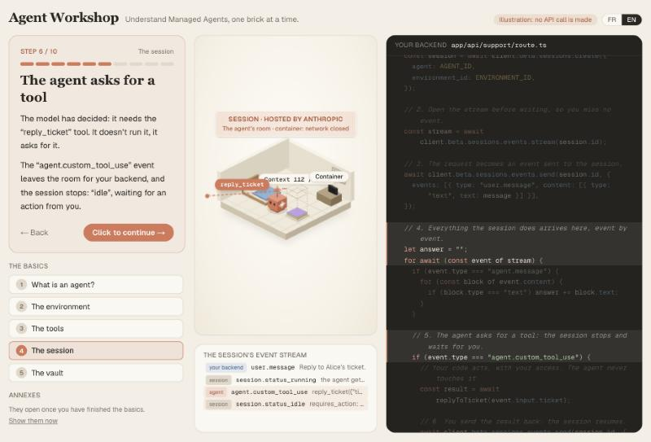
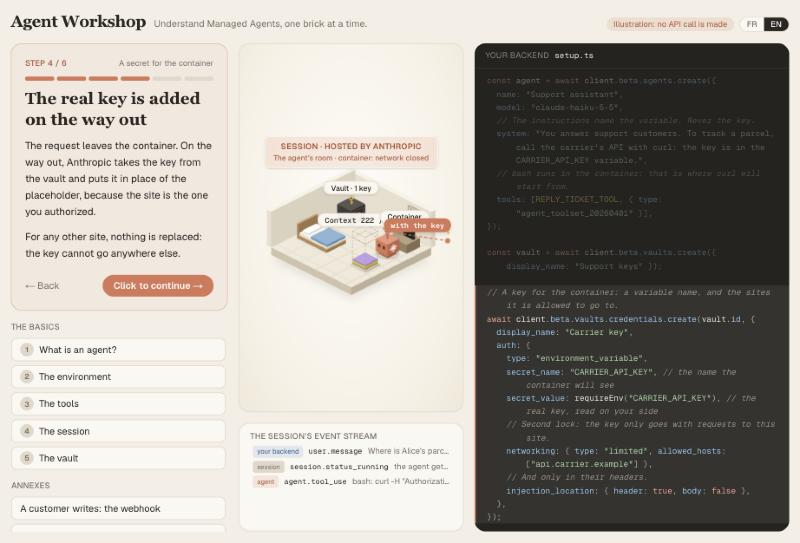
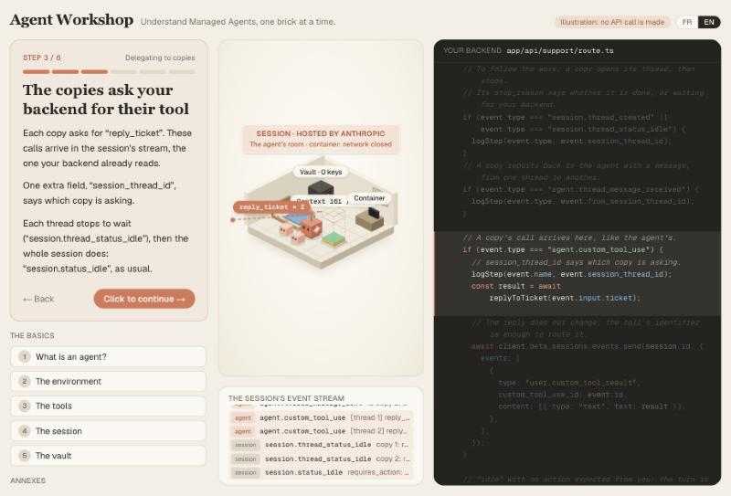

# Managed Agents, a visual guide

**English** · [Français](README.fr.md)

An interactive, click-through lesson that shows what an AI agent is, what
[Claude Managed Agents](https://platform.claude.com/docs/en/managed-agents/overview) runs for you,
and how you plug an agent into your own backend. One small scene, one step at a time.



## Why this exists

"Agent" is easy to say and hard to picture. Where does it run? Who actually sends the email or
issues the refund? What does it remember? What can it never see?

This guide answers those questions by showing them. A little character lives in a room, a request
comes in, and you watch what moves where. It is written for two kinds of readers:

- **If you don't write code**, follow the left panel and the room in the middle. You will come out
  knowing what an agent is, what it can and cannot do alone, and why some things happen "on your
  side" and others "at Anthropic".
- **If you do**, the right panel shows the real backend code for each step, with the lines that
  matter lit up, and the event stream underneath shows exactly what your server receives.

The running example is a customer-support desk: someone asks the agent to reply to Alice's ticket.

## What you see on screen

| Where | What |
| --- | --- |
| Left | The current step, in plain words. Click anywhere to move on. |
| Middle | The agent's room: the session, hosted by Anthropic. The stack next to the agent is its context window, the workbench is its container, the safe is the vault. Calls leave the room on the left when they go to your backend, on the right when they go to an outside service. |
| Right | The backend code, with the blocks the step talks about highlighted. |
| Bottom | The session's event stream, with who emitted each event. |

## A few stops along the way

| | |
| --- | --- |
|  | **Start from zero.** A model, tools, a loop: that is an agent. Then what Managed Agents takes off your hands. |
|  | **The agent asks, your backend acts.** The session pauses until your code has run the tool and sent the result back. |
|  | **Secrets the agent never sees.** The key joins the request on its way out; the container only ever holds a placeholder. |
|  | **Several agents at once.** The agent hands tickets to copies of itself, each with its own thread and its own context. |

## What it covers

**The basics**, five chapters that build on the same scene:

1. **What is an agent?** A model, tools, a loop, and what Managed Agents hosts for you.
2. **The environment.** The container where the agent works, and its network.
3. **The tools.** Yours, the built-in ones, and those of a third-party service.
4. **The session.** The wiring to your backend: open a session, open its stream, send a message,
   run the tool the agent asks for, send the result back.
5. **The vault.** The keys the agent never sees.

**Seventeen annexes**, one topic each, unlocked once the basics are done:

- **Other ways to start a turn:** a webhook, a scheduled deployment.
- **Keeping a session alive:** several turns in one conversation, resuming after a dropped
  connection, interrupting the agent.
- **Tools and secrets:** your approval before a sensitive call, bash and files in the container,
  a secret for the container, web tools, skills.
- **Limits:** a budget per session, a full context window (compaction), failures.
- **Going further:** memory across sessions, delegating to copies, graded outcomes, agent versions.

## Try it

You need Node.js and [pnpm](https://pnpm.io).

```bash
pnpm install
```

```bash
pnpm dev
```

Then open `http://localhost:3000/en` (English) or `http://localhost:3000` (French). The FR / EN
switch in the top-right corner changes language without leaving the current step.

Any step has an address you can share: `http://localhost:3000/en?chapter=session&step=5`.

## It is an illustration

Everything runs in your browser. **No API call is made**, and you do not need an API key. The steps
are written by hand, and the code on screen follows the real shapes of the SDK, but nothing is
executed.

The content was checked against the official documentation on 26 November 2026: event names,
fields, SDK calls, and what runs where. Managed Agents is in beta, so check again when the docs
change.

Deliberate simplifications:

- The context window is 1,500 tokens, and tokens are roughly estimated.
- The summary produced by compaction is invented: the platform does not say what it keeps.
- The event stream is trimmed: `span.*` events, and the `session.usage` that precedes every switch
  to idle, are left out (except in the budget annex).
- The stack only lists the `reply_ticket` tool, even when the lesson's agent has others.

This is an unofficial, personal project. It is not affiliated with or endorsed by Anthropic.

## For developers

Next.js (App Router), React, TypeScript, Tailwind CSS, Vitest.

```bash
pnpm test
```

- `lib/lesson/`: the lessons in French, the original (`base/` for the five chapters, `extras/` for
  the annexes), the displayed code, its highlighting, and the step-by-step playback, all tested.
- `lib/lesson/en/`: the same lessons in English, file for file. `parity.test.ts` checks that both
  languages have the same steps, the same code and the same playback, so any change to a lesson is
  made in both trees.
- `lib/i18n/`: the languages, and the interface text in each.
- `lib/workshop/`: the state of the session and the room (events, context window, positions).
- `lib/iso/`: the isometric projection.
- `components/lesson/`: the page (step text, code, stream, table of contents).
- `components/workshop/scene/`: the drawing of the agent's room.
- `archive/`: two abandoned versions, neither compiled nor tested.
